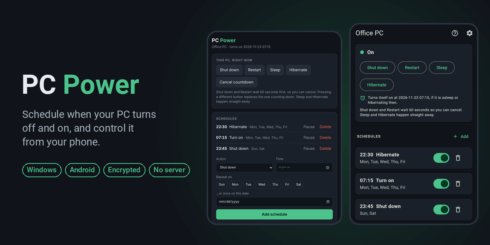
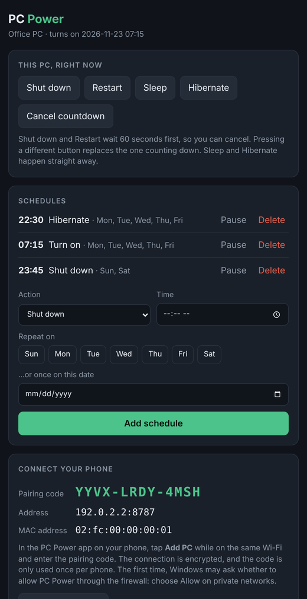
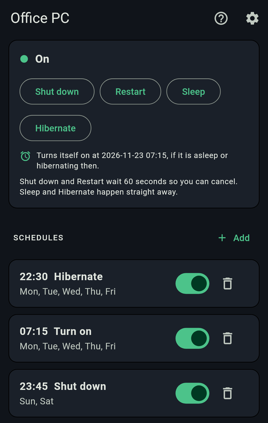

# PC Power

Schedule when your PC turns off and on, and control it from your phone. A Windows tray app and an
Android app that talk directly to each other: no account, no server, nothing collected.

> **Status:** early release. It runs on my own PC and phone; it has not been tested widely yet and
> is not on the app stores. Expect rough edges.

## What it does

- **Turn off on a schedule or on demand:** shut down, restart, sleep or hibernate, on chosen days or a single date.
- **Turn on from your phone** with Wake-on-LAN, on your home network or, with router setup, from outside.
- **Turn on by schedule:** the PC wakes itself from sleep or hibernate at a set time.
- **Safe by design:** shut down and restart count down for 60 seconds and can be cancelled; conflicting requests are resolved in one place.
- **Knows when the PC is in use:** a scheduled turn-off waits for recent keyboard or mouse use, full-screen apps, programs keeping the PC awake and busy downloads, unless the schedule says otherwise.
- **Timers and rules:** "turn off in 45 minutes", "sleep after an hour of nobody using it", and days off for repeating schedules.
- **Lock, screen off and mute** from the phone.
- **Runs before sign-in:** installs as a Windows service, with a proper entry in Installed apps to remove it.
- **Widget and quick tile** on Android to turn a PC on without opening the app. With several PCs, one that is on relays the wake signal for the others.
- **Activity list** showing what happened on the PC and who asked.
- **Guided setup:** the app checks the PC's wake settings, explains the BIOS and router steps, and can test the away-from-home route.

| Windows app | Android app |
| --- | --- |
|  |  |

## How it is built

| Part | Tech | Notes |
| --- | --- | --- |
| [`windows-app/`](windows-app) | Go | One small program. Installed, it runs as a Windows service with a tray helper per signed-in user; it can also run as a portable tray app. Keeps the schedules, performs the power actions, serves phones over HTTPS. |
| [`android-app/`](android-app) | Flutter (Dart) | Finds PCs on the network, pairs, sends the wake signal, manages schedules. |
| [`docs/legal/`](docs/legal) | | Terms of Use, Privacy Policy and third-party notices, generated by [`tools/legal.py`](tools/legal.py) into both apps. |

## Security

- **Encrypted:** phone and PC talk over TLS 1.3 only. The PC makes its own certificate; the phone pins it at pairing and refuses any other.
- **Pairing:** a 12-character code shown on the PC and never sent over the network. Both sides prove they know it, bound to the PC's certificate, so an interceptor fails even with the right code.
- **Per-phone access:** each phone gets its own random 256-bit token; the PC stores only a hash and lists phones so they can be removed.
- **Home network by default:** requests from public addresses are refused unless the owner allows them, and pairing never works from outside.
- **Local window:** served on 127.0.0.1 only, with protections against other websites calling it.

Known limits: the Wake-on-LAN signal itself has no authentication (that is the standard), so anyone
already on the same network can turn a PC on, though not off. The Windows program is not code-signed.
The design has not had an independent security review. Found a problem? Email muneermilleror@gmail.com.

The plan for an optional relay server, which would not be able to read or forge anything, is in
[docs/RELAY-DESIGN.md](docs/RELAY-DESIGN.md). It is not built.

## Build it yourself

Windows app (Go 1.24+; cross-compiles from any OS):

    cd windows-app
    GOOS=windows GOARCH=amd64 go build -ldflags "-H windowsgui -s -w" -o PCPower.exe .

Android app (Flutter 3.50+):

    cd android-app
    flutter test
    flutter build apk --release

[`tools/windows-smoke-test.ps1`](tools/windows-smoke-test.ps1) installs the Windows app as a service on a real Windows machine with power actions set to log-only, checks it, and uninstalls. GitHub Actions runs it on every push.

## Setting up a PC to be turned on

1. Use an Ethernet cable if you can. On Wi-Fi, a PC can usually be woken from sleep but not after a full shut down.
2. In the BIOS, enable Wake-on-LAN and turn ErP off. On MSI boards set **Wake Up Event By** to **OS**; left on BIOS, the PC may power itself back on seconds after every shut down.
3. Run PC Power on the PC and open "Can this PC be turned on remotely?". It shows what is wrong and can fix the Windows settings after you approve.
4. On the phone, tap **Add PC** on the same network and enter the pairing code.

## Legal

Using PC Power is covered by the [Terms of Use](docs/legal/terms.md) and [Privacy Policy](docs/legal/privacy.md).
The code is source-available, not open source: see [LICENSE.md](LICENSE.md).

## Credits

Made by [Muneer Miller](https://github.com/MuneerMiller), built with the help of Claude, Anthropic's AI model.
